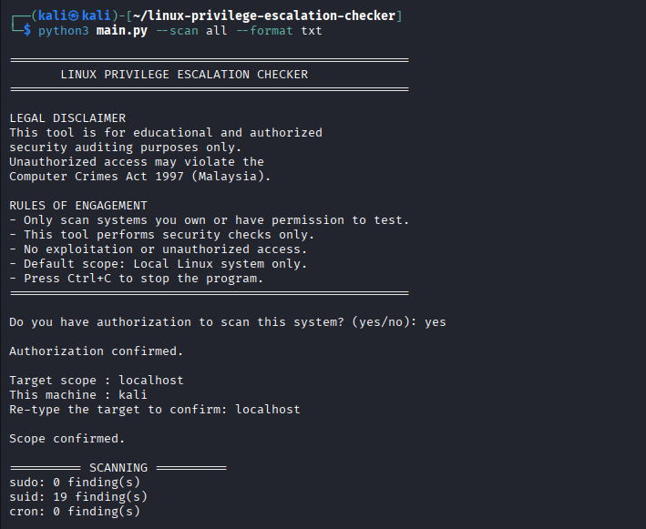
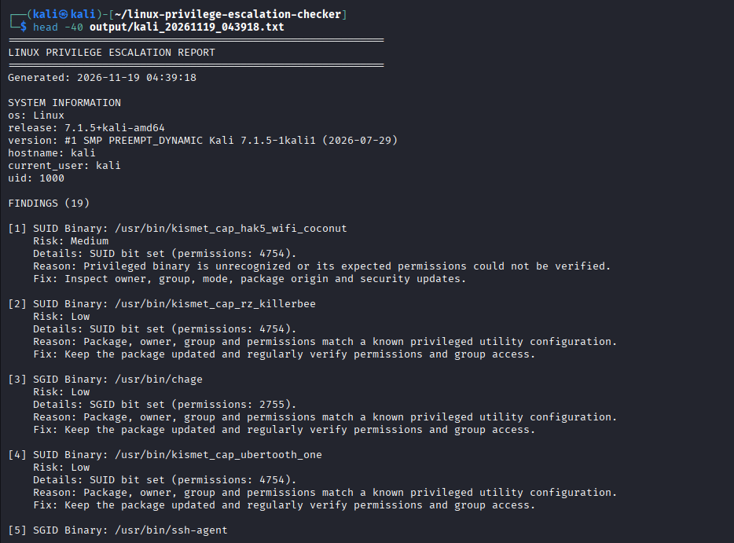

# Linux Privilege Escalation Checker

A read-only Python auditing tool that detects potential Linux privilege escalation misconfigurations, rates each finding as Low, Medium or High, explains why it matters and recommends how to fix it.

- **Attack category:** Category 4 - OS-Specific Attack (privilege escalation checker / misconfiguration auditor)
- **Language:** Python 3 (standard library only)
- **Target systems:** Kali Linux, Debian and Ubuntu
- **Version:** 1.0.0

> **For authorized security auditing and education only.** Read the [Legal Disclaimer](#12-legal-disclaimer) and [Rules of Engagement](#9-rules-of-engagement-roe) before running the tool.

---

## 1. Description

Linux privilege escalation often needs no sophisticated exploit. A single misconfiguration, such as a SUID binary that can spawn a shell or a root cron job that any user can edit, can turn a low-privilege account into root.

This tool **audits** the local machine for such misconfigurations. It does not exploit them. For every finding it reports:

- **what** was found and where,
- a **risk level** (Low, Medium, High),
- **why** it is a security risk,
- a **recommendation** for fixing it.

Unlike large enumeration scripts such as LinPEAS, this tool focuses on a small set of high-value checks and gives short, readable explanations, so a system owner can act on the results quickly.

## 2. Features

- **Sudo check:** reads the current user's sudo rules (`sudo -n -l`) and checks whether `/etc/sudoers` is readable by non-root users.
- **SUID/SGID check:** finds files with SUID or SGID bits in `/usr/bin` and `/usr/local/bin`.
- **Cron check:** checks system cron files (`/etc/crontab`, `/etc/cron.d`, `/etc/cron.hourly`, `/etc/cron.daily`, `/etc/cron.weekly`, `/etc/cron.monthly`) for write permissions that non-privileged users should not have.
- **Risk assessment:** classifies every finding and verifies standard system binaries by package, owner, group and permissions (Debian/Kali), which removes false positives.
- **Reports:** saves a labelled TXT or JSON report to a local `output/` folder.
- **Ethical safeguards:** legal banner, typed authorization, scope enforcement, dry-run mode and a kill switch (see [Section 8](#8-ethical-considerations)).

## 3. Attack Lifecycle Mapping

The tool operates at the **privilege escalation** stage of the attack lifecycle, after initial access to a system. It performs only the *discovery* part of that stage and never attempts exploitation.

| Lifecycle stage | Tool component | MITRE ATT&CK reference |
|---|---|---|
| Discovery | System information (OS, kernel, hostname, current user) | T1082 System Information Discovery |
| Privilege Escalation | Sudo rule and sudoers permission check | T1548.003 Sudo and Sudo Caching |
| Privilege Escalation | SUID/SGID binary detection | T1548.001 Setuid and Setgid |
| Privilege Escalation | Cron job permission check | T1053.003 Scheduled Task/Job: Cron |
| Reporting | Risk rating, explanation, recommendation, TXT/JSON report | (defensive output) |

**Data flow:**

```
main.py (CLI, authorization, scope)
   -> checkers (sudo_checker, suid_checker, cron_checker)
   -> risk_assessment (risk, reason, recommendation)
   -> report_generator (TXT / JSON in output/)
```

## 4. Installation

Requirements: Python 3.8 or newer. There are **no third-party dependencies** (see `requirements.txt`).

```bash
git clone https://github.com/catalyst009/linux-privilege-escalation-checker.git
cd linux-privilege-escalation-checker
python3 --version
python3 main.py --help
```

## 5. Usage

| Option | Description |
|---|---|
| `--scan {all,sudo,suid,cron}` | Run a scan directly |
| `--target TARGET` | Hostname you are authorized to audit (default: `localhost`) |
| `--format {txt,json}` | Report format (default: `txt`) |
| `--output OUTPUT` | Report directory (default: `output/`) |
| `--dry-run` | Show which checks would run, without scanning anything |
| `-h`, `--help` | Show help and examples |

**Examples**

```bash
python3 main.py --scan all
python3 main.py --scan sudo --format json
python3 main.py --scan suid --dry-run
python3 main.py --scan all --output output/
```

On every run the tool first displays the legal banner, asks you to type `yes` to confirm authorization, then asks you to re-type the target to confirm the scope.

**Example result (Kali Linux VM)**

```
========== RISK SUMMARY ==========
Total Findings : 20
High Risk      : 0
Medium Risk    : 3
Low Risk       : 17
==================================
Report saved to: output/<hostname>_<timestamp>.txt
```

## 6. Risk Levels

| Level | Meaning | Examples |
|---|---|---|
| **High** | Likely route to root or a serious misconfiguration | Privileged binary writable by group or others; SUID on interpreters or editors such as `find`, `vim`, `python`; passwordless sudo for any command |
| **Medium** | Needs manual review | Unrecognized privileged binary; sudo rules; readable `/etc/sudoers`; writable scheduled-task files |
| **Low** | Verified standard utility | SUID/SGID binary whose package, owner, group and permissions match a known Debian configuration |

Every finding in the report also contains a **reason** (why it is risky) and a **recommendation** (how to fix it).

## 7. Screenshots

**Startup banner, authorization and scan**



**Kill switch (Ctrl+C)**


**Sample report**



## 8. Ethical Considerations

The tool is designed so that it is difficult to misuse by accident.

| Safeguard | What it does | Why |
|---|---|---|
| Legal disclaimer | Shows a banner citing the Computer Crimes Act 1997 (Malaysia); the user must type `yes` | Makes the user consciously confirm authorization before anything runs |
| Scope enforcement | Only `localhost`, `127.0.0.1` or the machine's own hostname are accepted; the user must re-type the target | Prevents scanning the wrong system, and the tool has no way to reach remote hosts |
| Safe defaults | Default target is `localhost`; default output is a local `output/` folder | A user who forgets options is still safe |
| Dry-run mode | `--dry-run` lists the checks that would run and scans nothing | Lets users see what will happen first |
| Kill switch | `Ctrl+C` stops the program cleanly and prints an emergency-stop message | The user can always abort |
| Read-only checks | Only reads permissions and configuration; contains no exploit code and never modifies the system | Auditing is not exploiting |
| Local data only | Reports stay on the local disk; the tool sends nothing over the network | Scan results are sensitive |

## 9. Rules of Engagement (RoE)

### Authorized scope
- Only systems that **you own** or for which you hold **explicit written permission** to test.
- The tool audits the **local machine only**. For coursework, use your own Kali or Ubuntu lab VM.

### Time windows
- Run the tool only inside a window agreed in advance with the system owner, for example a scheduled lab session or maintenance window.
- Do not run it on shared or production systems during business hours without approval.
- Record the start and end time of every assessment.

### Permitted techniques
- Reading file permissions and ownership, and checking SUID/SGID bits.
- Reading sudo rules with `sudo -n -l` and checking sudoers file permissions.
- Reading system cron file permissions and basic system information.
- Generating local TXT/JSON reports.

### Prohibited actions
- Using the tool on any system without explicit written authorization.
- Exploiting any finding, attempting to gain root access or modifying files, permissions or configuration.
- Guessing or cracking passwords.
- Scanning or attacking remote hosts.
- Publishing, uploading or sharing reports from systems that are not yours.
- Removing the disclaimer or scope checks from the code.

### Emergency stop procedures
1. Press **Ctrl+C**. The tool stops and prints `Emergency stop activated. Program terminated.`
2. If the terminal does not respond, close it, or run `pkill -f main.py` from another terminal.
3. If you ran the tool on the wrong system, stop immediately, tell the system owner and delete the generated report from `output/`.
4. The tool never changes the system, so nothing needs to be rolled back.

## 10. Data Handling

- Reports are saved **only on the local disk**, in `output/`, named `<hostname>_<timestamp>.<txt|json>`.
- A report contains system information (hostname, user, kernel) and file paths, so treat it as **sensitive**.
- `output/` is excluded by `.gitignore`, so reports are not committed. If you use a different `--output` directory, make sure it is not committed either.
- The tool does not store credentials and does not transmit data over the network.
- Delete reports you no longer need.

## 11. Responsible Disclosure

If you find a real weakness while using this tool:

- **Who to report to:** the owner or administrator of the system, or the organization's security contact. If the weakness is in third-party software, report to that vendor or maintainer. For serious incidents in Malaysia, MyCERT (CyberSecurity Malaysia) accepts reports.
- **When:** report **High** findings promptly, ideally within 24 to 48 hours of confirming them. Send Medium and Low findings in a single report within about 7 days. Allow the owner reasonable time to fix before discussing details publicly (90 days is a common standard for vendor issues).
- **How:** use a private channel (direct email or a secure ticket), never a public issue or chat. Include a description, the affected path, the risk level, an excerpt of the report and the recommended fix. Do not include exploitation steps.
- **For this tool:** report bugs through GitHub Issues. For security-sensitive bugs, contact the repository owner (`catalyst009`) privately through GitHub.

## 12. Legal Disclaimer

This tool is provided for **educational and authorized security auditing purposes only**. Unauthorized access to computer systems is a criminal offence under Malaysia's **Computer Crimes Act 1997 (Act 563)** and under similar laws in other countries. You are solely responsible for obtaining permission before running this tool. The authors accept no liability for misuse or damage (see the MIT License).

## 13. Limitations

- Package verification uses `dpkg`, so it works fully on **Debian-based systems** (Kali, Debian, Ubuntu). On other distributions, standard privileged binaries are reported as Medium instead of Low.
- The SUID/SGID scan covers only `/usr/bin` and `/usr/local/bin`.
- `sudo -n -l` cannot list rules when sudo requires a password, so the sudo check may report nothing even though the user can use sudo.
- Cron checks cover the standard `/etc/cron*` locations only, not per-user crontabs or systemd timers.
- Findings are **indicators**, not proof that a vulnerability can be exploited.
- Each run is a one-time snapshot, not continuous monitoring.
- The interactive menu (running without `--scan`) is still under development. Use the `--scan` option.
- The Linux capabilities check in `scanner.py` is not part of the default scan yet.

## 14. Testing

- Tested on a Kali Linux VM.
- Unit tests for the report generator are in `test_report_generator.py`.
- Manual detection test (use a lab VM only):

```bash
sudo touch /etc/cron.d/zz_test_writable
sudo chmod 666 /etc/cron.d/zz_test_writable
python3 main.py --scan cron        # expected: cron: 1 finding(s)
sudo rm /etc/cron.d/zz_test_writable
```

## 15. Team

| Member | Name | GitHub | Responsibility |
|---|---|---|---|
| 1 | Nur Aliya Binti Mohd Yusri | catalyst009 | CLI, authorization, scope check, kill switch, dry-run, integration, repository management |
| 2 | Syasya Syazwina Binti Mohd Zabidi | syzsade | Detection modules (sudo, SUID/SGID, cron, system information) |
| 3 | Shakirul Irfan Bin Sazali Affandi | kirulrfan | Risk assessment module |
| 4 | Nur Airiel Amir Bin Muhamad Hazlim | airiel | Report generation, testing, documentation |

## 16. License

Released under the [MIT License](LICENSE).