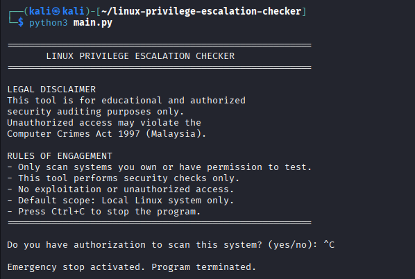

# Linux Privilege Escalation Checker

## 1. Project Description
Linux Privilege Escalation Checker is a Python-based security auditing tool designed to identify potential privilege escalation misconfigurations in Linux systems.

The tool focuses on selected security checks and provides risk levels, explanations, and recommendations to help users understand and address potential security weaknesses.

## 2. Attack Category
**Category 4 – OS-Specific Attack**

## 3. Main Features
- System Information Gathering
- Sudo Permission Checking
- SUID/SGID File Detection
- Cron Job Permission Checking
- Risk Classification (Low, Medium, High)
- Security Recommendations
- TXT/JSON Report Generation

## 4. Attack Lifecycle Mapping
The tool supports the **Reconnaissance** stage by gathering Linux system information and identifying potential privilege escalation weaknesses.

## 5. Programming Language
Python

## 6. Target Operating System
- Kali Linux
- Ubuntu Linux

## 7. Project Status
Under Development

## 8. Ethical Considerations
- Only scan systems with proper authorization.
- Use read-only security checks.
- Do not execute exploits or attempt to gain unauthorized root access.
- Do not collect or store sensitive information unnecessarily.

## 9. Legal Disclaimer
This tool is developed for educational and authorized security auditing purposes only. Users must obtain explicit permission before conducting security assessments. Unauthorized access to computer systems may violate Malaysia's Computer Crimes Act 1997.

## 10. Limitations
The tool focuses on selected Linux privilege escalation misconfigurations. Its findings indicate potential risks and do not confirm that a vulnerability can be successfully exploited.

## 11. Installation

### Requirements
- Kali Linux or Ubuntu Linux
- Python 3
- No external packages (the tool uses the Python standard library only)

### Steps
```bash
git clone https://github.com/catalyst009/linux-privilege-escalation-checker.git
cd linux-privilege-escalation-checker
python3 --version
pip install -r requirements.txt
python3 main.py --help
```

`pip install -r requirements.txt` installs nothing extra because there are no external dependencies, but it keeps the setup the same if a package is added later. If `python3 main.py --help` prints the usage text, the installation worked.

## 12. Usage

### Options
| Option | Description |
|--------|-------------|
| `--scan {all,sudo,suid,cron}` | Run a scan directly. If you leave it out, the interactive menu opens. |
| `--target TARGET` | Hostname you are authorized to audit (default: `localhost`). |
| `--format {txt,json}` | Report format. |
| `--output OUTPUT` | Folder where reports are saved (default: `output/`). |
| `--dry-run` | Show what would run, but scan nothing. |
| `-h`, `--help` | Show the help message. |

### Examples
```bash
# Open the interactive menu
python3 main.py

# Run all checks
python3 main.py --scan all

# Run only the sudo check and save a JSON report
python3 main.py --scan sudo --format json

# Preview the SUID check without scanning anything
python3 main.py --scan suid --dry-run

# Run all checks and save reports in a custom folder
python3 main.py --scan all --output reports/
```

### Safe usage tips
- The default target is `localhost`, so the tool audits your own machine unless you choose a different target.
- Use `--dry-run` first to see what a scan will do before running it.
- Reports are saved locally in the output folder. Do not share them publicly, because they describe the weaknesses of a system.

## 13. Rules of Engagement (RoE)

These rules define how this tool may be used. By running the tool, the user agrees to follow them.

### Authorized Scope
- The tool may only be used on a system that the user owns, or on a system where the owner has given **explicit written permission**.
- The default target is `localhost`. Any other target must be named in the written permission.
- The tool asks the user to confirm authorization (`yes/no`) and to re-type the target before it starts. If authorization is not confirmed, the tool exits.

### Time Windows
- Scans may only run during the testing period agreed with the system owner, for example a maintenance window or a lab session.
- Outside the agreed period, no scan should be run.
- The tool does not enforce time windows. It is the user's responsibility to follow them.

### Permitted Techniques
- Reading system information.
- Checking sudo permissions.
- Listing SUID/SGID files.
- Checking cron job permissions.
- Saving the results as a TXT or JSON report in the local output folder.

All checks are read-only and do not change the system.

### Prohibited Actions
- Scanning any system without authorization.
- Using the findings to exploit a weakness or gain root access.
- Changing, deleting, or creating files on the target system.
- Sending reports or findings to anyone who is not the system owner or the testing team.
- Publishing reports that contain details about a real system.

### Emergency Stop
- Press **Ctrl+C** at any time to stop the tool.
- Answer **no** at the authorization prompt to exit before any scan starts.
- If the tool behaves unexpectedly, stop it, do not run it again, and tell the system owner.

## 14. Responsible Disclosure

If this tool finds a weakness on a system, or you find a bug in the tool itself, please follow these steps.

### Who to Tell
- **A weakness found on a system:** tell the owner or administrator of that system. This is the person who gave you written permission to scan it.
- **A weakness in software (for example, a SUID program):** tell the maintainer or vendor of that software through their security contact.
- **A bug or security problem in this tool:** open a private report on this repository's GitHub page (Security tab), or contact the repository owner.
- **A lab or class system:** tell your lecturer or lab supervisor.

### When to Tell
- Report **High** risk findings as soon as possible, ideally within 24 to 48 hours.
- Report **Medium** and **Low** findings together with the full report, within one week.
- Give the owner reasonable time to fix the problem (a common period is up to 90 days) before anyone talks about it in public.

### How to Report
1. Write the report in private (for example, email or a direct message). Do not post it in a public place.
2. Include the date and time of the scan, the check that found the problem (sudo, SUID, or cron), the risk level, a short explanation, and the recommended fix from the report.
3. Send only what is needed. Do not include passwords, personal data, or full file contents.
4. Keep the report file in the local output folder and share it only with the system owner.
5. Do not try to exploit the weakness to "prove" it. The tool's findings show a potential risk, not a confirmed vulnerability.
6. Delete your copy of the report when the owner has fixed the problem and you no longer need it.

## 15. Screenshots

### Startup, legal disclaimer, authorization and scan
The tool shows the legal disclaimer (Computer Crimes Act 1997) and the Rules of Engagement, asks for authorization, confirms the scope (`localhost`), and then runs the checks.


### Kill switch
Pressing `Ctrl+C` at any time stops the tool cleanly.



### Sample report
Each report shows the system information and the findings, with a risk level, details, reason, and fix for every finding.


